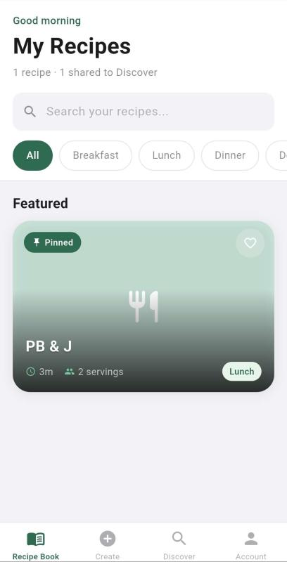
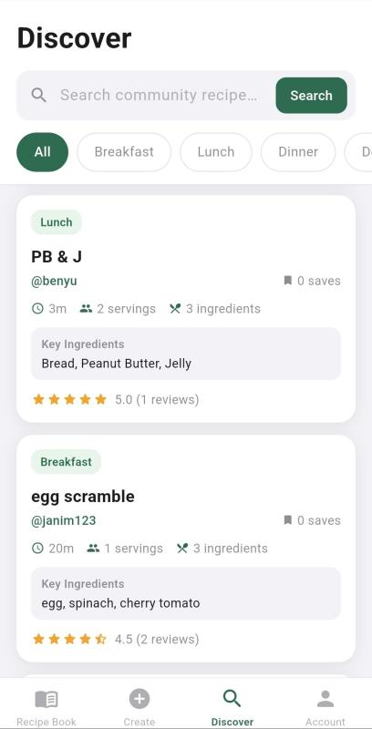
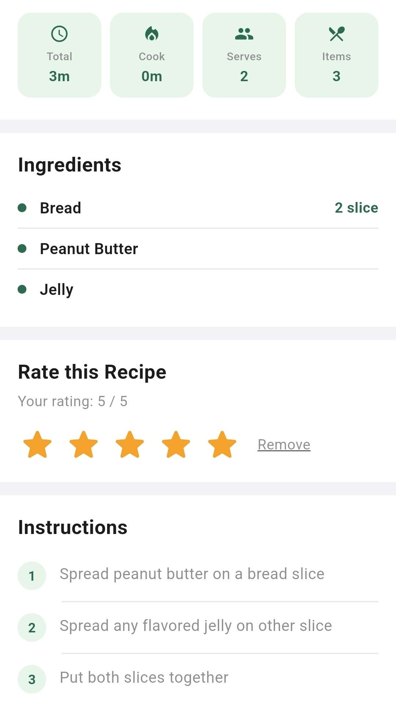
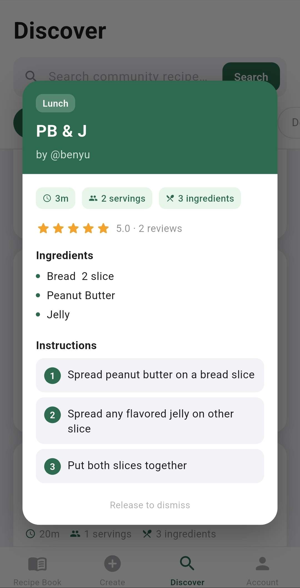
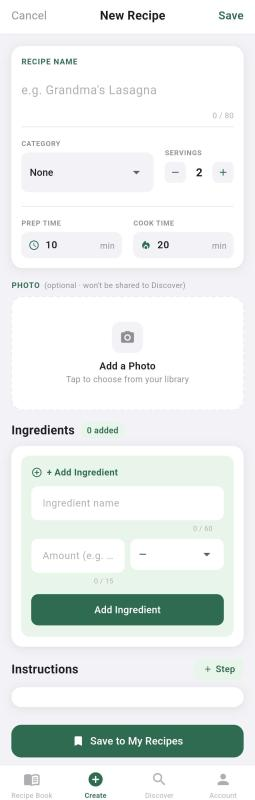
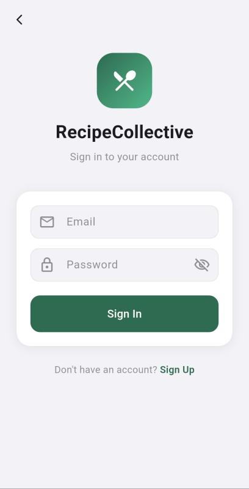
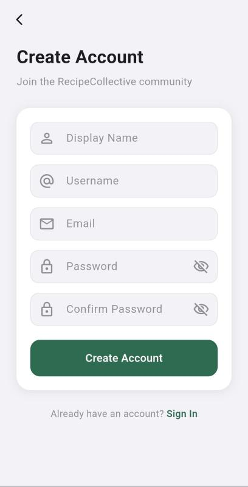
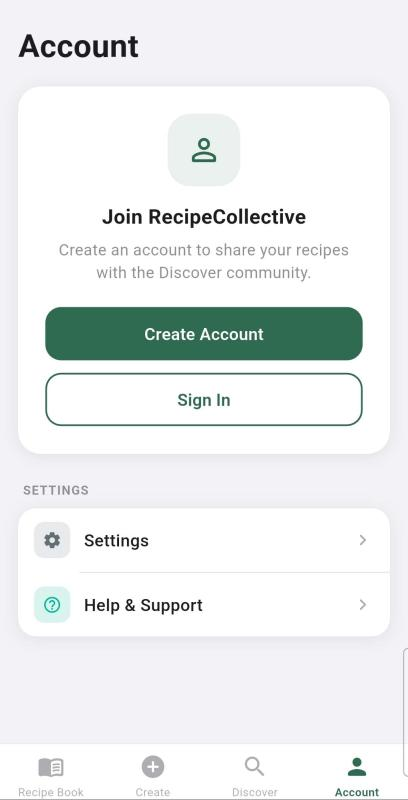
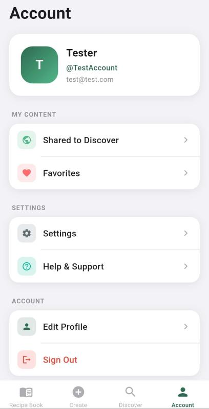
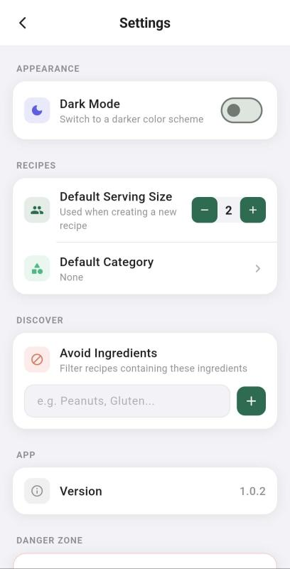

# RecipeCollective

A Flutter recipe app for building a personal recipe book and sharing favourites
with a community feed. Recipes live on the device and work offline. Users can
sign in to publish recipes to Discover, where others can browse, rate, and save
them. 


## Features
- **Personal recipe book:** create recipes with a photo, category, prep and cook times, servings, ingredients (amount, unit, preparation), and step-by-step instructions, then edit, favourite, or delete them
- **Works offline:** your recipe book is stored on the device, so you don't need an account or a connection to use it
- **Discover feed:** a community feed of shared recipes with search, category filters (Breakfast, Lunch, Dinner, Dessert, Drinks, Snacks), pull-to-refresh, and infinite scroll
- **Share & save:** signed-in users can publish up to 10 recipes to Discover and save anyone's recipe into their own book. Save counts are tracked for each recipe
- **Ratings:** 1–5 star ratings, one per user per recipe. Users can change or remove their rating, and the average updates live
- **Avoid ingredients:** set ingredients to avoid (allergies, dislikes) and Discover hides any recipe that contains them
- **Content moderation:** recipe titles, ingredients, and steps are checked by a profanity filter before they can be shared
- **Accounts:** email/password sign-up with unique usernames, profile editing, and full account deletion that also removes your shared recipes and ratings
- **Personalisation:** dark mode, default servings, default category, and unit preferences, all saved between sessions

## Tech Stack
- **App:** Dart, Flutter, google_fonts, cached_network_image, image_picker
- **Local storage:** SQLite via sqflite (recipes), shared_preferences (settings)
- **Backend:** Firebase Cloud Firestore (shared recipes, ratings, user profiles) with security rules
- **Auth:** Firebase Authentication (email/password)
- **Platform:** Android

## Architecture
The app has four tabs (Recipe Book, Create, Discover, Account) inside a swipeable
`PageView` that keeps each tab's state alive. Data is split by ownership. A
user's own recipes are stored in a local SQLite database behind a `RecipeStore`
singleton, which exposes a `ValueNotifier` so every screen updates when a recipe
changes. Shared recipes live in Firestore under `hub_recipes`, with a `ratings`
subcollection that holds one document per user. `AuthService` and
`FirestoreService` wrap Firebase so the screens never call the SDK directly.

```
                 ┌──► RecipeStore ──► SQLite (my recipe book, offline)
Flutter UI ──────┤
(4-tab PageView) ├──► FirestoreService ──► Cloud Firestore
                 │                         ├─ hub_recipes/{id}
                 │                         │   └─ ratings/{uid}
                 │                         └─ users/{uid}
                 └──► AuthService ──► Firebase Auth
```

## Screenshots
## Screenshots
| Recipe Book | Discover Page | Recipe Preview | Hold To Preview | New Recipe |
|---|---|---|---|---|
|  |  |  |  |  |

| Login | Create Account | Account Page | Account Page Logged In | Settings |
|---|---|---|---|---|
|  |  |  |  |  |

## What I Learned
- **Offline first, cloud when it matters:** I kept each user's recipe book in SQLite so the core app works with no account and no signal, and used Firestore only for shared content. Changing the local schema meant writing versioned `onUpgrade` migrations (for example, adding `savedFromHub` and `authorId` columns) so updates never wiped existing recipes.
- **Keeping ratings consistent:** Each rating is its own document keyed by user ID, and the recipe stores a running `ratingSum` and `reviewCount`. Firestore transactions update both together, so the average stays correct when users rate, change, or remove ratings at the same time. Firestore also doesn't delete subcollections when you delete a document, so unsharing a recipe clears its ratings first. Otherwise old ratings would come back if the recipe was shared again.
- **Security beyond the UI:** Firestore security rules enforce ownership on the server. Users can only edit their own profile and rating, and only the author can delete a shared recipe or clear its ratings. Account deletion requires re-authentication and removes everything the user published.
- **Avoiding index sprawl:** I fetch Discover pages ordered by date and apply category, search, and avoided-ingredient filters on the client. This keeps the Firestore setup free of composite indexes while the dataset is small.

---
Source code is private. Available on request.
